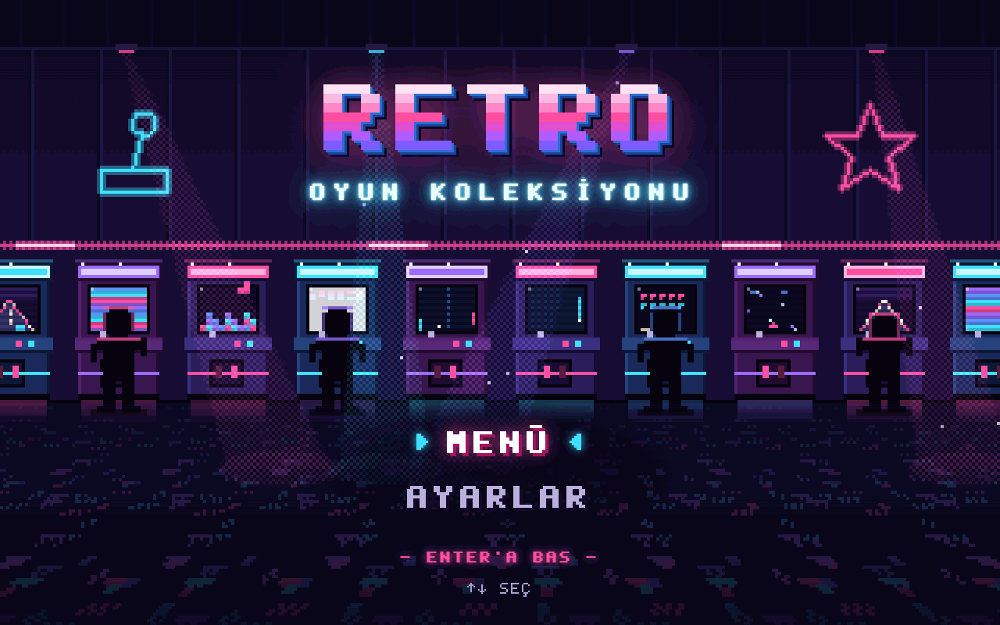
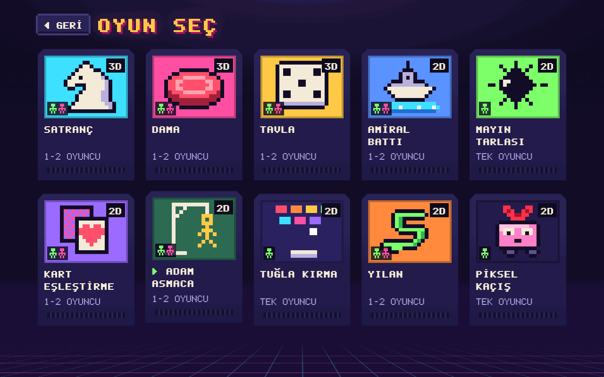
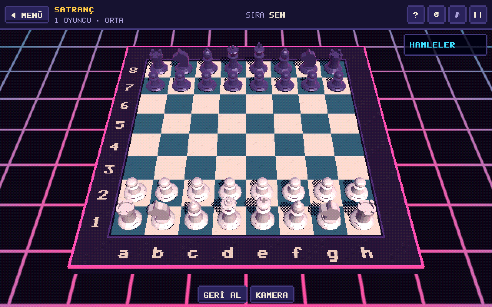
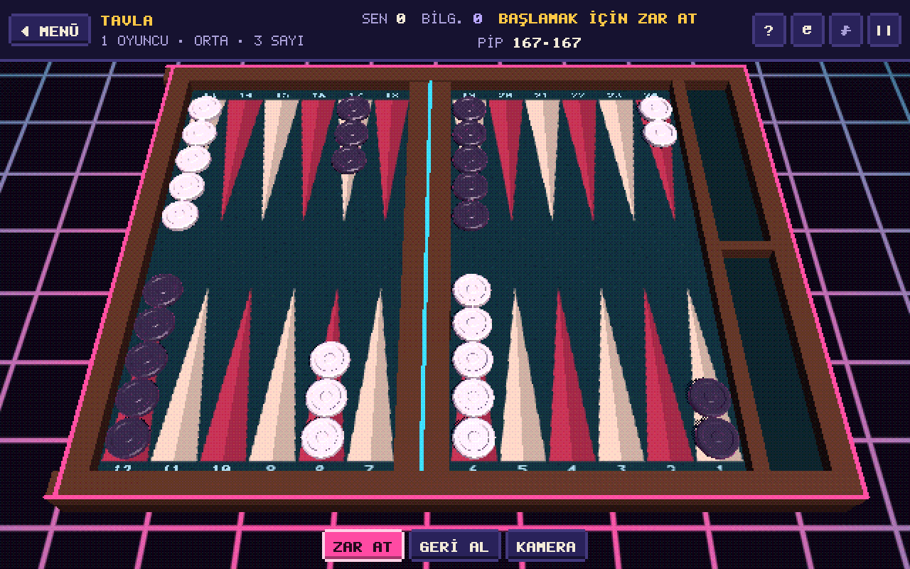
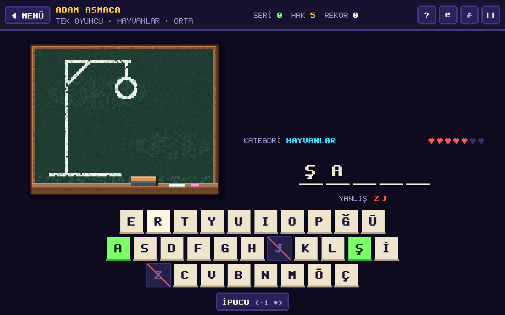
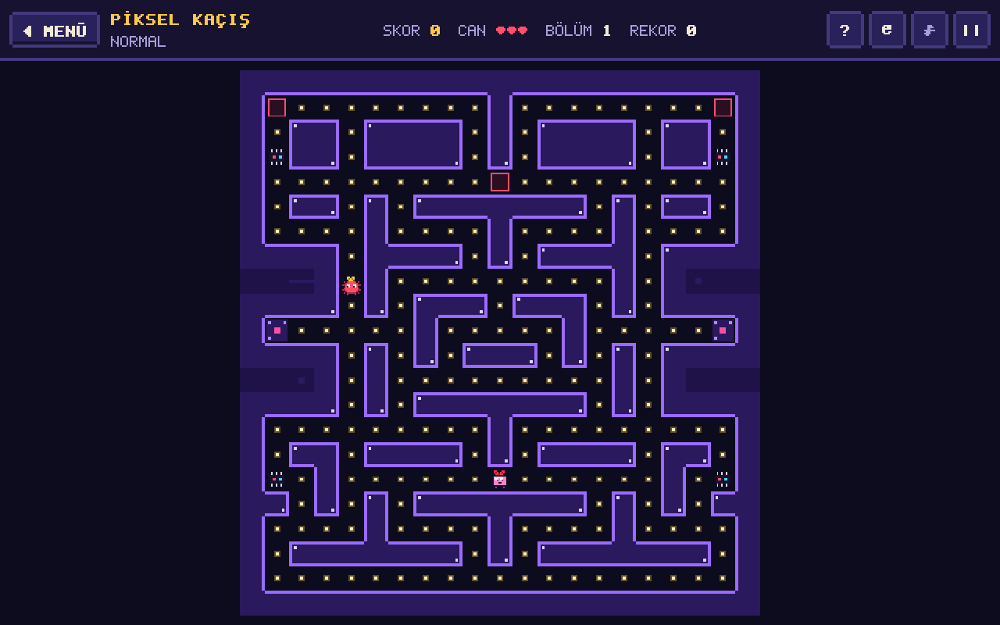
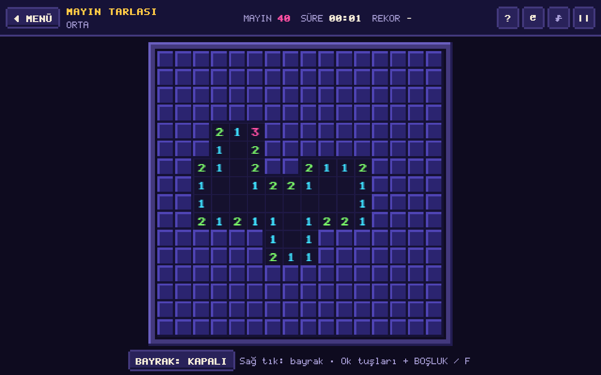

<div align="center">

# Retro Oyun Koleksiyonu

**Tarayıcıda çalışan, neon atari salonu temalı 10 oyunluk retro oyun koleksiyonu**

Tek HTML dosyası · Kurulum gerektirmez · İnternetsiz çalışır


[Canlı Demo](https://iremasyaa.github.io/retro-oyun-koleksiyonu/) · [Özellikler](#özellikler) · [Kurulum](#kurulum) · [Geliştirme](#geliştirme)



</div>

## İçindekiler

- [Hakkında](#hakkında)
- [Oyunlar](#oyunlar)
- [Özellikler](#özellikler)
- [Zorluk Seviyeleri](#zorluk-seviyeleri)
- [Ekran Görüntüleri](#ekran-görüntüleri)
- [Kurulum](#kurulum)
- [Kontroller](#kontroller)
- [Geliştirme](#geliştirme)
- [Proje Yapısı](#proje-yapısı)
- [Teknolojiler](#teknolojiler)
- [Tarayıcı Desteği](#tarayıcı-desteği)
- [Lisans](#lisans)

## Hakkında

Retro Oyun Koleksiyonu; satranç, tavla ve dama gibi klasik masa oyunlarını, mayın tarlası ve yılan gibi atari klasiklerini tek bir çatı altında toplayan bir web uygulamasıdır. Tüm oyunlar, stiller, yazı tipi ve sesler tek bir `index.html` dosyasına paketlenir. Uygulama hiçbir sunucuya, eklentiye ya da internet bağlantısına ihtiyaç duymaz.

## Oyunlar

| Oyun | Görünüm | Tek oyuncu | İki oyuncu |
|---|:---:|:---:|:---:|
| Satranç | 3D | Bilgisayara karşı, 3 seviye | ✓ |
| Dama | 3D | Bilgisayara karşı, 3 seviye | ✓ |
| Tavla | 3D | Bilgisayara karşı, 3 seviye | ✓ |
| Amiral Battı | 2D | Bilgisayara karşı, 3 seviye | ✓ |
| Kart Eşleştirme | 2D | Tek başına ya da bilgisayara karşı | ✓ |
| Adam Asmaca | 2D | 8 kategori, 490 Türkçe kelime | ✓ |
| Yılan | 2D | ✓ | ✓ (aynı klavye) |
| Mayın Tarlası | 2D | ✓ | — |
| Tuğla Kırma | 2D | ✓ | — |
| Piksel Kaçış | 2D | ✓ | — |

## Özellikler

- **3D oyun tahtaları:** Satranç, dama ve tavla, projeye özel yazılmış hafif bir WebGL motoruyla döndürülebilir ve yakınlaştırılabilir 3D sahnelerde oynanır.
- **Yapay zekâ rakipler:** Satrançta alfa-beta budamalı arama motoru, damada negamax, tavlada olasılık hesabına dayalı hamle seçimi kullanılır. Hesaplamalar Web Worker üzerinde çalıştığı için arayüz akıcı kalır.
- **Gerçek zamanlı ses:** Tüm efektler ve müzik Web Audio API ile anlık olarak üretilir; projede ses dosyası bulunmaz.
- **Özel piksel yazı tipi:** Türkçe karakterleri destekleyen RetroPix yazı tipi Python ile üretilir ve dosyaya gömülür.
- **Canlı giriş ekranı:** Piksel sanatıyla çizilmiş, hareketli bir atari salonu sahnesi.
- **Duyarlı tasarım:** Masaüstü, tablet ve telefonda çalışır; klavye, fare ve dokunmatik ekranla kullanılabilir.
- **Kalıcı kayıt:** Rekorlar ve ayarlar tarayıcının yerel depolamasında saklanır.
- **Erişilebilirlik:** Menüler klavyeyle gezilebilir; işletim sisteminin hareket azaltma tercihine uyulur.

## Zorluk Seviyeleri

Seviyeler, simüle edilmiş oyunlarla ölçülerek eşit adımlarla zorlaşacak şekilde ayarlanmıştır. Ölçümler `npm test` ile tekrarlanabilir.

| Oyun | Ölçüt | Kolay | Orta | Zor |
|---|---|:---:|:---:|:---:|
| Satranç | Hesaplanan yarım hamle | 1 | 2 | 3 |
| Dama | Hesaplanan yarım hamle | 1 | 3 | 8 |
| Tavla | Bir alt seviyeye karşı kazanılan el | — | %67 | %66 |
| Kart Eşleştirme | Ortalama oyuncuya karşı bilgisayarın bulduğu çift | %38 | %50 | %63 |
| Amiral Battı | Ortalama oyuncuya karşı bilgisayarın kazanma oranı | %23 | %48 | %76 |
| Adam Asmaca | Hak / harf sayısı | 10 / 3-6 | 8 / 5-8 | 6 / 7+ |
| Mayın Tarlası | Tarla / mayın | 9×9 / 10 | 16×16 / 40 | 30×16 / 88 |

Satranç ve damada her seviye bir alttakine karşı oyunların %93-97'sini kazanır.

## Ekran Görüntüleri

| Oyun seçimi | Satranç |
|:---:|:---:|
|  |  |
| **Tavla** | **Adam Asmaca** |
|  |  |
| **Piksel Kaçış** | **Mayın Tarlası** |
|  |  |

## Kurulum

### Tarayıcıda oynama

Oyun GitHub Pages üzerinden doğrudan oynanabilir: **https://iremasyaa.github.io/retro-oyun-koleksiyonu/**

### Yerel olarak çalıştırma

```bash
git clone https://github.com/iremasyaa/retro-oyun-koleksiyonu.git
```

Ardından `index.html` dosyasını herhangi bir güncel tarayıcıda açmak yeterlidir.

## Kontroller

| Tuş | İşlev |
|---|---|
| `↑` `↓` `←` `→` | Menülerde gezinme |
| `Enter` | Seçme ve onaylama |
| `Esc` | Duraklatma ya da geri dönme |
| `P` | Aksiyon oyunlarında duraklatma |
| `R` | Amiral Battı'da gemiyi döndürme |

Her oyunun içindeki **?** düğmesi, o oyunun kurallarını ve kontrollerini gösterir.

## Geliştirme

**Gereksinimler:** [Node.js](https://nodejs.org) 18 veya üzeri

```bash
npm install
npm run build
npm test
```

| Komut | Açıklama |
|---|---|
| `npm install` | Geliştirme bağımlılıklarını kurar |
| `npm run build` | `index.html` dosyasını ve `dist/` klasörünü yeniden üretir |
| `npm test` | Satranç, tavla ve zorluk seviyesi testlerini çalıştırır |

Piksel yazı tipini yeniden üretmek için Python 3 ve fontTools gerekir:

```bash
pip install fonttools
python3 tools/makefont.py src/fonts.css
```

## Proje Yapısı

```text
retro-oyun-koleksiyonu/
├── index.html          Derlenmiş, tek dosyalık uygulama
├── build.mjs           Paketleme betiği
├── package.json
├── LICENSE             MIT lisans metni
├── src/
│   ├── main.js         Giriş noktası
│   ├── styles.css      Arayüz stilleri
│   ├── fonts.css       Gömülü RetroPix yazı tipi
│   ├── core/           Arayüz kabuğu, ses, çizim ve giriş sahnesi
│   ├── gl/             WebGL motoru
│   ├── ai/             Yapay zekâ için Web Worker
│   └── games/          Oyunlar
├── tests/              Otomatik testler
├── tools/              Yazı tipi üretici
└── docs/ekran/         Ekran görüntüleri
```

## Teknolojiler

| Alan | Kullanılan |
|---|---|
| Dil | JavaScript (ES2019+), çerçevesiz |
| Grafik | WebGL 1, Canvas 2D |
| Ses | Web Audio API |
| Eşzamanlılık | Web Worker |
| Paketleme | esbuild |
| Yazı tipi üretimi | Python, fontTools |

## Tarayıcı Desteği

Chrome, Edge, Firefox ve Safari'nin güncel sürümleri desteklenir. 3D oyunlar için WebGL desteği gereklidir.

## Lisans

Bu proje [MIT lisansı](LICENSE) ile yayınlanmıştır.
